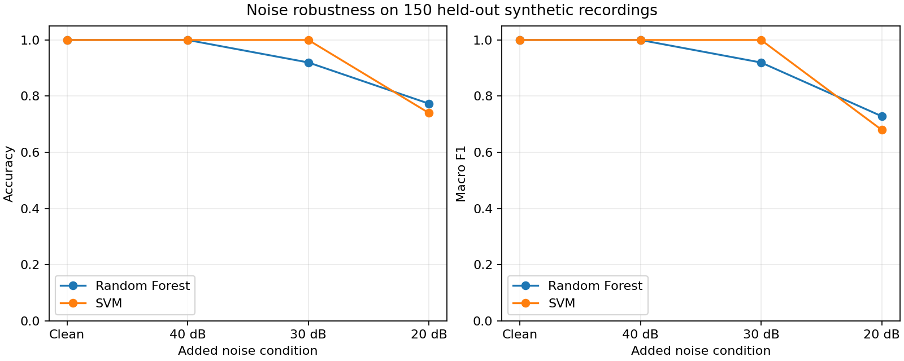

# Noise robustness experiment

Compared the frozen clean-trained models on the same 150 held-out recordings.
Noise is added only to test copies. Models and preprocessing are not refitted.

| Condition | Model | Accuracy | Macro F1 |
| --- | --- | ---: | ---: |
| clean | random_forest | 1.0000 | 1.0000 |
| clean | svm | 1.0000 | 1.0000 |
| 40_db | random_forest | 1.0000 | 1.0000 |
| 40_db | svm | 1.0000 | 1.0000 |
| 30_db | random_forest | 0.9200 | 0.9198 |
| 30_db | svm | 1.0000 | 1.0000 |
| 20_db | random_forest | 0.7733 | 0.7286 |
| 20_db | svm | 0.7400 | 0.6800 |

Gaussian noise is seeded per recording and mean-centered, then scaled to exact
measured SNR. The browser uses a fresh random Gaussian draw at the target
expected noise power, so individual browser predictions may differ.

These results describe one noise realization per recording and this simplified
generator. They do not establish field accuracy or cover non-Gaussian noise.
Full confusion matrices, per-class scores, IDs, and checksums are in results.json.
