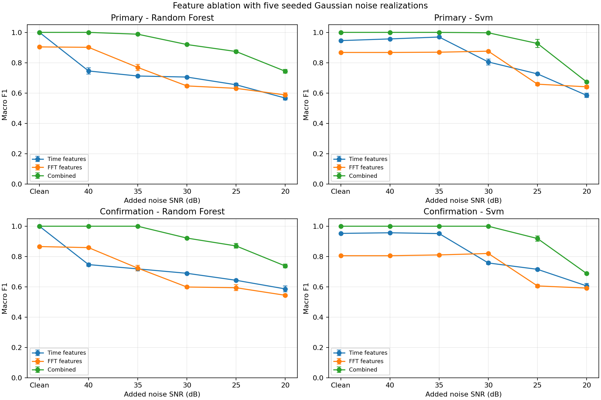

# Research findings and reproduction

This local prototype classifies five simplified voltage-signal classes. The
research question is how measurement noise affects Random Forest and SVM
classification, and whether time-domain, FFT, or combined features are more useful.
The evidence below was generated on 22 November 2026. It does not establish
performance on electrical equipment.

## Experimental design

The primary generator seed is 42: 1,000 recordings, 200 per class, split into
700 training, 150 validation and 150 test recordings. Each recording has 1,200
samples at 6 kHz and a nominal 60 Hz fundamental. Generation parameters vary
within the documented [ranges](../Data/README.md). Labels and metadata never
enter the feature matrix. Noisy copies stay with their parent test recording.

Six time features are RMS, absolute peak, crest factor, and minimum, maximum
and standard deviation of sliding-cycle RMS divided by whole-recording RMS.
Four frequency features are dominant frequency and third-harmonic,
fifth-harmonic and remaining AC power fractions. FFT features use a Hann
window. They are not certified total harmonic distortion measurements.

Each feature group uses the same two-candidate grid per classifier as the
baseline. Random Forest uses 200 trees, leaf size 2, seed 42 and depth 8 or
unrestricted. SVM uses training-only StandardScaler, RBF kernel, gamma scale
and C 1 or 10. Primary validation macro F1 selects a candidate; ties choose
the first. All models remain fitted on the primary training records only.
The SVM pipeline follows the train-only preprocessing principle in the
[scikit-learn documentation](https://scikit-learn.org/1.6/common_pitfalls.html).

The additional experiment evaluates clean, 40, 35, 30, 25 and 20 dB SNR.
For each noisy condition, five seeds (2026-2030) produce centered Gaussian
noise scaled to exact measured SNR: 10 log10(mean(signal squared) /
mean(noise squared)). A recording and seed share the same noise direction
across SNR levels. Higher SNR means less noise. Error bars are standard
deviations across noise realizations, not confidence intervals over equipment
or independently trained models. Five noisy copies of 150 recordings do not
constitute 750 independent source recordings.

A second, previously unused generator seed (43) supplies another 150 test
recordings, 30 per class. Its training and validation portions are unused.
It checks generalization within the same generator; it is not an independent
physical domain. The feature study is exploratory because the original test
results had already been inspected in the baseline. Neither test partition
is used for candidate selection or fitting.

## Measured results

Mean accuracy with all ten features, over five noise realizations per noisy
condition (one evaluation for clean):

| SNR | Primary RF | Primary SVM | Second-seed RF | Second-seed SVM |
| --- | ---: | ---: | ---: | ---: |
| Clean | 100.00% | 100.00% | 100.00% | 100.00% |
| 40 dB | 100.00% | 100.00% | 100.00% | 100.00% |
| 35 dB | 98.80% | 100.00% | 100.00% | 100.00% |
| 30 dB | 92.00% | 99.73% | 92.40% | 100.00% |
| 25 dB | 87.73% | 92.93% | 87.60% | 92.27% |
| 20 dB | 78.27% | 73.20% | 78.27% | 74.80% |

Primary test macro F1 at 20 dB:

| Model | Time only | FFT only | Combined |
| --- | ---: | ---: | ---: |
| Random Forest | 0.5667 | 0.5872 | 0.7436 |
| SVM | 0.5845 | 0.6409 | 0.6730 |

**Hypothesis 1, FFT features withstand noise better than time features:**
mixed evidence. FFT-only macro F1 is higher at primary 20 dB, but the
advantage does not hold at all noise levels or on both second-seed models.
Combined features have the strongest overall scores in these comparisons.
The small tuning grid limits conclusions about feature groups in general.

**Hypothesis 2, accuracy falls as noise increases:** supported overall by
the combined models, with plateaus at low noise. Results do not require every
individual feature group to decrease monotonically; some improve slightly.
Using an explicitly chosen 90% mean-accuracy criterion, the first sampled
failure while increasing noise is 25 dB for RF and 20 dB for SVM, on both
test partitions. These locate grid intervals, not exact operating thresholds.

**Hypothesis 3, harmonics are more robust than sag and swell:** only partly
supported. At primary 20 dB the combined RF/SVM harmonic recall is 100%,
sag recall 81.33%/84.00%, and swell recall 100%/100%. Harmonics outperform
sag but tie swell. Normal recall is just 10%/0%; the example first noise
run misclassifies 27/30 normal records as swell with RF and 30/30 with SVM.
This is an important failure, rather than evidence of reliable troubleshooting.
The second seed has similar weaknesses. Per-class recall does not establish
precision or overall accuracy; all metrics and confusion matrices are retained.



Full [JSON](Results/research_results.json) stores candidate validation scores,
feature names, all source IDs, checksums, versions, per-seed confusion matrices
and per-class reports. The [CSV](Results/research_summary.csv) contains means
and standard deviations. Original one-noise-realization baseline results in
`../Models/noise_experiment/` remain separate; differences from those scores
reflect additional noise seeds. The serving model bundle was not replaced.

## Reference waveforms and literature

The [reference audit](Reference/reference_audit.json) checks finite values,
shape and SHA-256 of five supplied `RawData` CSVs (repository root in a full clone, or the standalone
Implementation workspace). The audit detects either layout. Each has 1,000 rows by 100
samples. `Details.txt` states 50 Hz, 5 kHz and 20 ms, unlike the classifier's
60 Hz, 6 kHz, 200 ms contract. Its amplitude description is not a universal
bound: swell records exceed a magnitude of one. None of these files is
silently resampled, used for model training, or reported as external test accuracy.

The [comparison figure](Reference/reference_shapes.png) puts the first row
of each file beside a project example at matching reference sampling settings.
Normal rows have a sine shape; sag and swell scale a local portion down/up;
interruption approaches zero; harmonics change the sine shape. The examples
differ in event timing, severity and phase; parameters were not fitted to
make the curves match. This checks qualitative construction only.

The metadata matches the candidate
[SEED Kaggle source](https://www.kaggle.com/datasets/sumairaziz/seed-power-quality-disturbance-dataset).
The original download, licence and byte identity have not been verified.
Treat the supplied files as reference material, not confirmed hardware data
or IEEE DataPort measurements. No additional reference data is redistributed
by this milestone. General sag, swell and harmonic concepts also agree with
[Fluke's manufacturer guidance](https://www.fluke.com/en/learn/blog/power-quality/moving-up-to-three-phase-power-quality-measurements).
This is not a claim of standards certification.

Jain, S., Satsangi, A., Kumar, R., Panwar, D., and Amir, M. (2025),
*Intelligent assessment of power quality disturbances: A comprehensive review
on machine learning and deep learning solutions*, Computers and Electrical
Engineering, 123, 110275.
[DOI](https://doi.org/10.1016/j.compeleceng.2025.110275).
Their case study uses MATLAB, five simple/complex disturbances, 20 records
per class, a 70/30 split, triggering and transform-derived statistical features.
Table 8 reports 96.67% test accuracy for Bagged Trees and 93.33% for Coarse
Gaussian SVM. The abstract rounds the former to 96.6%. Different classes,
features, splits and record counts prevent a direct ranking against this
prototype's 100% clean synthetic result. This work is a simpler related
experiment, not a reproduction or an improvement claim.

## Reproduce from the Implementation folder

Install `BackEnd/requirements.txt`, then generate the primary dataset if it is
absent. Nonempty output folders are preserved. The research command creates
the seed-43 dataset if absent, validates manifests and rejects overlapping IDs.

```bash
python BackEnd/generate_dataset.py
python BackEnd/research_validation.py --output Research/Results_repeat
python BackEnd/validate_reference_signals.py --output Research/Reference_repeat
python BackEnd/verify_application.py
python -m unittest discover -s BackEnd/tests -v
node --test FrontEnd/tests/history.test.cjs
```

The optional live handler integration check needs generated example CSVs and
an app already running. It adds eleven analyses to that app's local history:

```bash
node FrontEnd/tests/live_workflow.cjs http://127.0.0.1:5000
```

Fresh-install and browser verification details are in
[Verification/README.md](Verification/README.md). Use the
[demo and defense guide](DemoGuide.md) for the presentation.
